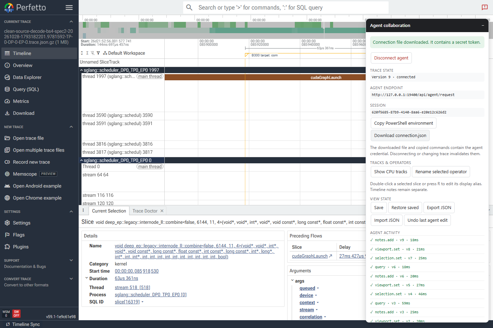
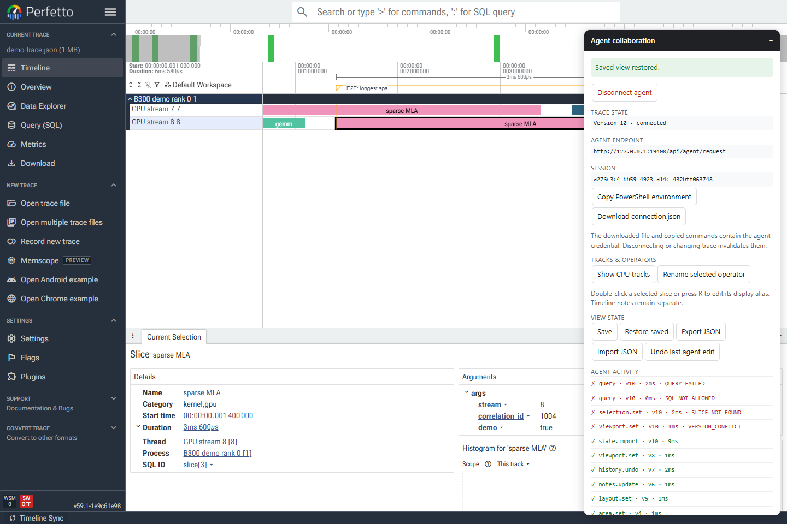
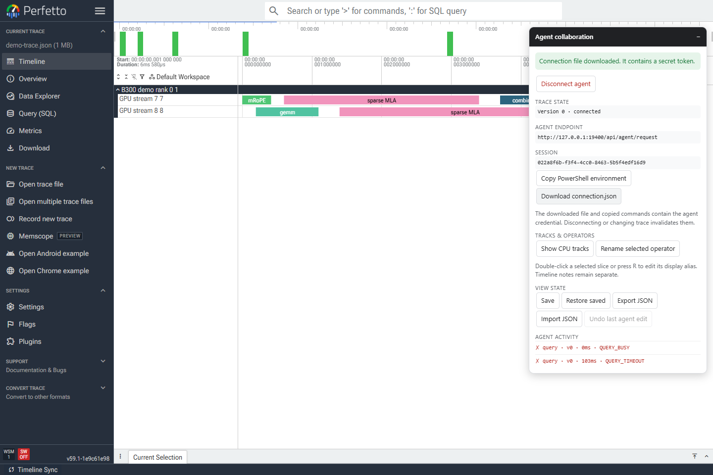
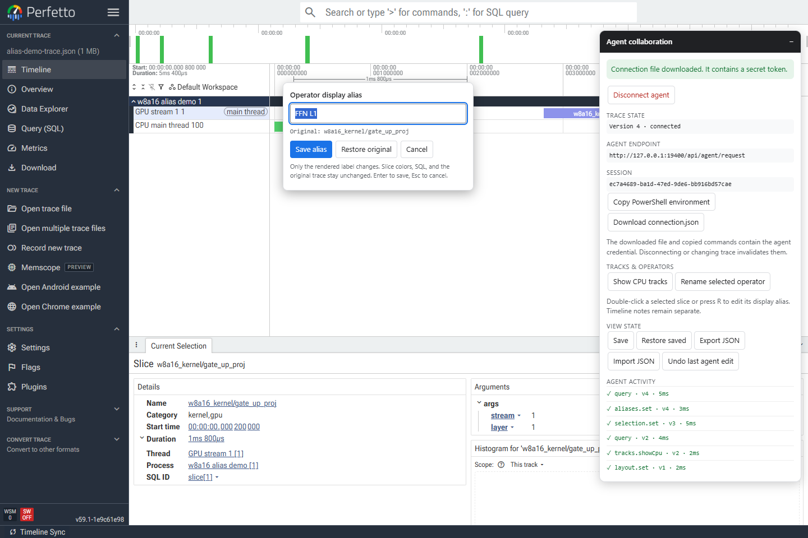
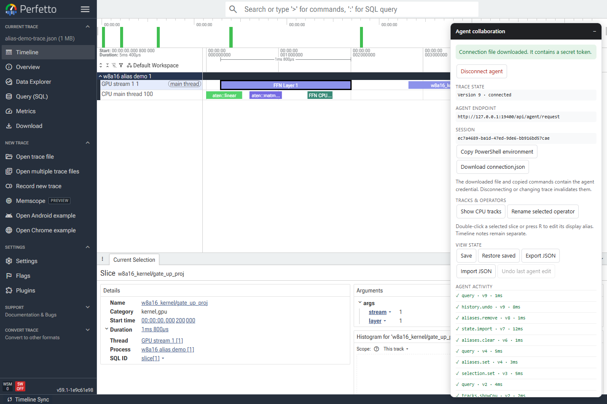

# 验收记录

日期：2026-10-28  
结论：**文档定义的第一版本地协作功能已实现，并通过 25 组单元测试和 4 个真实浏览器端到端场景。**

## 1. 交付与运行形态

- 默认使用官方 Perfetto **v59.1 完整发布 UI**，不是在线上 `ui.perfetto.dev` 中运行，也不是跨域 iframe。
- 官方 ZIP SHA-256：`df4433f5d8d98d2c490249870944c819ff85206f61e55e5983bbcc2338c83904`。
- 本地发布包已成功重复构建到 `ui-dist/`，含官方前端、Trace Processor WASM、traceconv、字体和 worker。
- 本地协作运行时 `collab.js` 在同一页面操作真实 `window.app.trace`。
- 最终服务地址：`http://127.0.0.1:19400/`。
- 最终健康检查：`{"ok":true,"service":"perfetto-local-collab","version":1}`。

### 源码构建路径的如实说明

本次验证了上游构建入口，但没有声称完成本机 C++/WASM 重编译：

1. 原生 Windows 上，官方 `tools/install-build-deps --ui` 明确返回 `Building the UI on Windows is unsupported`。
2. Ubuntu 22.04 WSL2 可进入官方依赖安装，但访问 `chromium.googlesource.com` 超时，完整依赖安装中断。
3. 因此默认交付改用与官方 v59.1 Release 严格对应的完整 UI 制品；`npm run build:source` 仅作为可选后续路径保留。

## 2. 最终执行结果

| 命令 | 结果 |
|---|---|
| `npm test` | 25/25 通过，0 失败 |
| `npm run build` | 通过；固定哈希再次打包成功 |
| `npm run test:e2e` | 4/4 通过，约 39 秒 |
| `npm audit` | 0 个已知漏洞 |
| `curl http://127.0.0.1:19400/api/health` | 通过 |

端到端 JSON 报告：[evidence/e2e-results.json](evidence/e2e-results.json)。

## 3. 原验收清单

| 验收项 | 结果与证据 |
|---|---|
| localhost 打开页面和本地 trace | 通过。Playwright 使用文件选择加载 JSON 与 `.json.gz`。 |
| 不依赖原 `172.18.64.32:28888` | 通过。所有正式操作只访问本地服务与浏览器 Engine。 |
| 未授权拒绝；断开后旧凭证立即失效 | 通过。服务端单元测试、真实 Disconnect 和关闭标签页测试。 |
| 用户能看到 agent 选中、缩放和标注 | 通过。主流程和 B300 截图均可见实际变化。 |
| SQL 与官方详情一致，int64 不丢精度 | 通过。`9007199254740993` 原样返回；详情显示 slice 名称、ID 和时长。 |
| 检查同/跨 stream 实际重叠 | 通过。按 `ts + dur` 做 SQL join；示例跨 track 有重叠，同 track 为 0，未用显示层叠推断。 |
| notes、时间窗和布局保存恢复；不兼容提示 | 通过。手动保存点与自动最新视图分槽；指纹和解析器不匹配在单元测试中拒绝。 |
| 一步撤销，且不覆盖后续用户编辑 | 通过。真实用户时间窗编辑后返回 `UNDO_CONFLICT`。 |
| 原始 trace 哈希不变，无未授权远程上传 | 通过。测试前后重新计算哈希；主流程记录到 0 个非回环网络请求。 |
| 错误 SQL、超时、断线、切换 trace、多标签页、过期 ID 均有测试 | 通过。真实错误 SQL、真实 Engine 超时、Disconnect、页面关闭、切换文件、多 session 隔离单元测试、无效 slice 和过期版本。 |
| B300 rank trace 定位 mRoPE / sparse MLA / combine | 通过。实际执行 `examples/b300-targets.mjs`，详情与 notes 可见。 |

异步视图操作期间的并发命令还会返回 `VIEW_BUSY`，避免读写中间状态。手动保存和面板日志延迟的问题也在最终回归前修复并重新验证。

## 4. 真实 B300 结果

输入文件：

```text
D:\looplm-forb\profiles\b300-clean-source-bs4-spec2-20261028\
clean-source-decode-bs4-spec2-20261028-1793182201.9781592-TP-0-DP-0-EP-0.trace.json.gz
```

原始 SHA-256（测试前后相同）：

```text
50925307869d19a898bd7578b6c706e7060621d9b472b8d9ee43b5ddff6a7892
```

| 目标 | slice ID | Trace Processor track ID | duration (ns) |
|---|---:|---:|---:|
| `fused_rope`（本 trace 的 mRoPE 定位入口） | 4366 | 118 | 3456 |
| `sparse_mla` | 3439 | 77 | 18593 |
| `deep_ep::legacy::internode_ll::combine` | 16319 | 454 | 63361 |

完整结果与长 kernel 名称：[evidence/b300-demo-result.json](evidence/b300-demo-result.json)。

**命名说明：**这份 trace 没有字面量 `mRoPE`，实际使用 `zops::decode::fused_rope_impl` 作为 mRoPE 相关定位入口；没有把它改写成不存在的 kernel 名称。



## 5. 主流程截图

下图显示 agent 选中的 `sparse MLA`、区间 note、官方详情和实时操作日志。日志中的红色错误是测试主动验证的 `SQL_NOT_ALLOWED`、`SLICE_NOT_FOUND` 和 `VERSION_CONFLICT`。



## 6. 真实查询超时

对真实 Engine 执行长递归查询，100ms 后返回 `QUERY_TIMEOUT`，`cancel_requested=false`、`underlying_query_may_run=true`；下一查询返回 `QUERY_BUSY`。关闭标签页后，旧 token 变为 `UNAUTHORIZED`。

下图中的 `QUERY_TIMEOUT`、`QUERY_BUSY` 为即时日志，左下角官方 WSM 状态仍显示一个查询在执行，语义一致。



## 7. CPU 可见性与图内算子别名

新增 `test/e2e/cpu-alias.spec.mjs`，使用 `examples/alias-demo-trace.json` 验证：

- 自动展开 CPU track 及其父分组；手动折叠父组后，`tracks.showCpu` 能重新展开。
- agent 将 `w8a16_kernel/gate_up_proj` 设置为 `FFN L1`，原始名称保持不变。
- 真实鼠标双击图内 slice 打开内联编辑器，再改成 `FFN Layer 1` 并保存。
- 使用原生 `sliceName` 和缓存版本刷新显示文字，配色仍按原始名称计算；slice 原底色与选择边框保留，不再铺白底。
- 别名导出/导入、清除、删除后撤销均正确；SQL 和原始 trace 中的 kernel 名不变。
- 原 timeline notes、B300 和超时场景在同一轮回归中全部通过。

CPU 未显示的实际原因是 thread 父组折叠，而非缺少 CPU 数据。B300 中 `cpu_op`、`user_annotation` 和 CUDA runtime 对应 `/slice_2`、`/slice_3`、`/slice_4`、`/slice_5`、`/slice_8`，现已能自动展开。

编辑器直接锚定在原 w8a16 slice 旁：



最终图内显示 `FFN Layer 1`，下方官方详情仍显示原始 `w8a16_kernel/gate_up_proj`：



## 8. 其他 trace 哈希

`examples/demo-trace.json` 在测试前后均为：

```text
b5703e7bb5d4149e91fc2ef680a138f84619ddd4defe05895323a906d01e7228
```

## 9. 测试工具说明与未覆盖边界

- 内置浏览器首页 DOM 检查通过，但文件上传能力不受支持，且其截图接口两次出现 3 秒准备超时。因此文件选择和视觉验收由本机 Edge + Playwright 完成；没有把这些内置能力记作成功。
- 上述最终 PNG 均已实际读取并进行视觉复核：官方时间线、详情、notes、track、别名编辑器、面板和日志可读，未发现阻断操作的布局问题。面板是可折叠的右侧覆盖层。
- 第一版使用浏览器内 Trace Processor WASM；没有无浏览器原生后端。查询需要标签页保持打开。
- 当前 Engine 没有公开取消 API；超时不会伪称已取消，旧查询未结束前阻止同会话新查询。
- 官方前端只有一个焦点 slice；notes 是全局时间线单点/区间，未伪称支持 track-bound note。
- 官方 ExtensionServers 的旧版远程 userscript 已禁用；远程扩展服务器不在第一版范围内。
- 本次 B300 文件约 744 KiB（gzip），不是大规模内存/性能基准。超大 trace 的 WASM 内存限制和原生后端仍需后续验证。
- 多标签页隔离由服务端真实 WebSocket 单元测试覆盖；未额外执行两个并行 GUI 标签页的完整视觉流程。
- 合并 stream、派生 track、算子链分析、跨电脑分享和多人协作属于后续功能，未列为已支持。

## 10. 复现

```powershell
cd D:\looplm-forb\perfetto-collab
npm install
npm run build
.\start.ps1
# 另一个 PowerShell 中运行单元测试和浏览器测试：
npm test
npm run test:e2e
```

其他 B300 文件可通过 `PERFETTO_B300_TRACE=<路径>` 指定；文件不存在时该场景会明确跳过，不计为通过。
